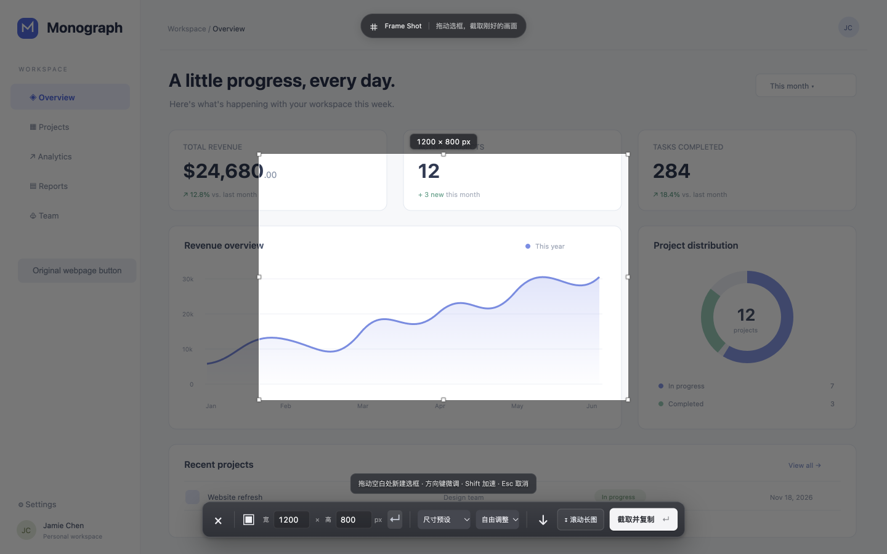
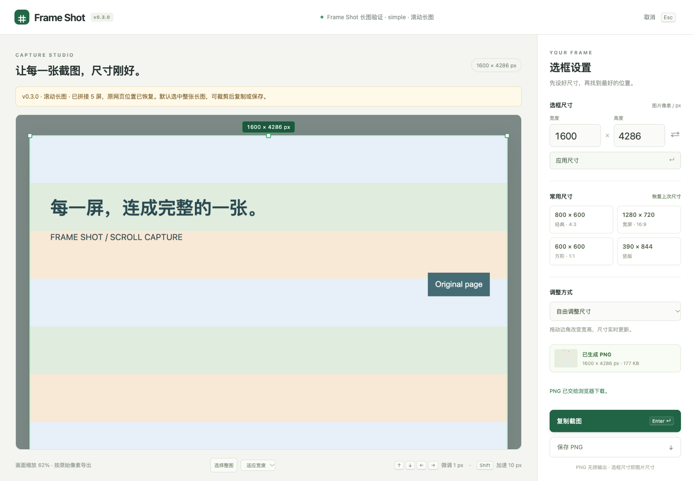

# FrameShot

**让每一张截图，尺寸刚好。**

FrameShot 是一款轻量的 Chrome 截图扩展。在原网页上使用 macOS 风格选框，输入目标尺寸、拖动微调，再将截图复制到剪贴板；也可以自动滚动网页，拼接并导出长图。

基于 Chrome Manifest V3，使用原生 JavaScript、HTML 和 CSS，无构建步骤、无第三方运行时依赖，无需注册账号或配置 API Key。

## 界面预览

### 原网页定尺寸截图



### 滚动长图与裁剪预览



以上为演示页面截图，不包含真实业务数据。

## 功能

- **指定尺寸**：输入宽高后，选框立即调整到目标像素尺寸。
- **手动微调**：拖动选框移动位置，拖动八个控制点改变大小；自由模式下可在暗区重新框选。
- **三种调整模式**：自由调整、锁定尺寸、锁定当前比例。
- **常用预设**：800 × 600、1280 × 720、600 × 600、390 × 844，自动记住上次选框尺寸。
- **复制和下载**：确认后复制 PNG 到系统剪贴板，也可直接保存无损 PNG。
- **滚动截长图**：自动滚动、逐屏拼接，支持提前完成、取消和继续裁剪。
- **像素尺寸导出**：宽高按最终图片像素计算，支持 Retina 和页面缩放下的坐标换算。
- **本机处理**：截图、裁剪与拼接在本机完成，无上传服务、统计上报或远程代码。

## 安装

当前版本为 **0.3.0**，通过 Chrome 开发者模式加载。

1. 下载仓库源码 ZIP 并解压，或克隆仓库。
2. 在 Chrome 地址栏输入 `chrome://extensions`。
3. 打开右上角的「开发者模式」。
4. 点击「加载已解压的扩展程序」，选择包含 `manifest.json` 的项目目录。
5. 在 Chrome 工具栏的扩展菜单中固定 Frame Shot。
6. 打开普通 HTTP / HTTPS 网页，点击扩展图标开始截图。

要求 Chrome 109 或更新版本。主要验证环境为 macOS；其他桌面平台的兼容性仍需进一步验证。无需运行本地服务器、安装 npm 依赖或安装 macOS 原生应用。

更新源码后，请在扩展管理页点击「重新加载」，关闭旧的截图界面，再重新触发截图。

## 使用

### 定尺寸截图

1. 点击扩展图标，当前网页显示冻结画面、选框和底部工具栏。
2. 输入宽高，离开输入框或点击应用按钮；也可直接选择尺寸预设。
3. 拖动选框确定位置，按需要切换调整模式。
4. 点击「截取并复制」或按 `Enter`，成功后自动退出遮罩，在目标应用中粘贴图片。

点击下载按钮可保存 PNG；保存后仍可继续调整。按 `Esc` 或点击关闭按钮可取消截图。

尺寸单位为**最终 PNG 的图片像素**，不是网页 CSS 像素。输入尺寸超出原图时会提示；不会通过放大图片凑足尺寸。粘贴后的显示大小由目标应用决定。

### 滚动截长图

1. 打开原网页选框后，点击工具栏中的「滚动长图」，或使用下方快捷键直接开始。
2. 扩展从页面顶部自动向下滚动；请保持当前标签页和窗口可见，不调整窗口大小或页面缩放。
3. 可点击「完成到这里」保留当前部分，或点击「取消」/ 按 `Esc` 放弃。
4. 完成后恢复原滚动位置，并打开结果编辑页，默认选中整张长图。
5. 使用「适应宽度」「适应窗口」「实际大小」查看，按需裁剪，再复制或保存 PNG。「选择整图」可恢复完整选区。

支持常规网页主体，以及外层页面无长内容时自动识别的主要内部滚动区域；后者仅输出该滚动主体。长图尺寸不会覆盖普通截图的尺寸偏好。

### 快捷键

| 操作 | macOS | Windows / Linux |
| --- | --- | --- |
| 打开截图选框 | `⌘ Shift Y` | `Ctrl Shift Y` |
| 直接开始滚动长图 | `⌘ Shift U` | `Ctrl Shift U` |
| 移动选框 1 px | 方向键 | 方向键 |
| 移动选框 10 px | `Shift` + 方向键 | `Shift` + 方向键 |
| 确认并复制 | `Enter` | `Enter` |
| 取消 | `Esc` | `Esc` |

扩展快捷键可能与系统或其他扩展冲突，可在 `chrome://extensions/shortcuts` 中修改。尺寸输入框获得焦点时，`Enter` 仅应用尺寸；按钮获得焦点时，`Enter` 执行该按钮。

## 隐私与权限

FrameShot 只截取用户主动操作的当前标签页，不截取浏览器工具栏或其他应用，不读取剪贴板，也不在后台持续截图。

| 权限 | 用途 |
| --- | --- |
| `activeTab` | 用户点击图标或使用快捷键后，临时访问当前标签页并截图 |
| `scripting` | 显示原网页选框，执行滚动截图及页面恢复 |
| `storage` | 保存上次使用的选框宽高 |
| `clipboardWrite` | 将用户确认的 PNG 写入剪贴板 |

不申请持久的全站主机访问权限。`overlay.html` 作为可嵌入的扩展界面公开，但截图读取另有来源标签页、捕获 ID 和扩展文档身份校验。

截图及网页标题会临时保存在扩展自身的 IndexedDB 中，用于选框和结果预览：

- 原网页选框取消、复制完成或源标签页关闭后，清理对应暂存记录。
- 独立结果编辑页关闭后，清理对应暂存记录。
- Chrome 启动时清空暂存记录；创建新截图时清理超过一小时的遗留记录，编辑页也拒绝打开过期记录。
- 浏览器未运行时不执行定时清理。临时存储不是加密保险箱，截图中可能包含你正在浏览的敏感内容。

持久偏好只保存选框宽高，不提供截图历史。主动保存的 PNG 和复制到系统剪贴板的图片由用户及系统管理，不随扩展暂存清理而删除。

## 已知限制

- FrameShot 是浏览器扩展；macOS 风格指界面设计，截图范围仅限浏览器标签页。
- Chrome 内置页面、其他扩展页面及部分受限制网站可能无法显示原网页选框，会尝试回退到独立编辑页；截图能力仍受 Chrome 限制。
- 受保护的视频或页面内容可能出现黑块或捕获失败。
- 滚动长图不保证完整捕获跨域 iframe 内部滚动、复杂虚拟列表、无限加载页面及持续动画。
- 为减少重复，滚动时会临时处理固定/粘性元素，结束或取消后恢复页面样式和位置；复杂布局仍可能影响结果。
- 长图单次上限为 **4800 万像素、30000 图片像素高、60 屏或约 90 秒**。达到任一限制时输出已捕获部分并明确标记。
- 切换标签页、改变窗口大小或截图比例变化可能中止长图任务。截图期间请保持页面稳定。
- 剪贴板写入受浏览器支持、页面策略及焦点状态影响；失败时可重试或保存 PNG。

## 本地开发

源码可直接作为已解压扩展加载，不需要构建。

```text
manifest.json          扩展配置与权限
background.js          截图入口、消息校验、降级与暂存清理
capture-tab.js         可见区域捕获、限流与重试
capture-store.js       IndexedDB 临时截图仓库
overlay-host.js        原网页容器与界面挂载
overlay.html/css/js    原网页选框、复制与下载
editor.html/css/js     独立编辑页与长图预览
geometry.js            选框坐标、移动、缩放与边界约束
scroll-page.js         滚动主体识别、进度与页面恢复
scroll-capture.js      逐屏截图、拼接与资源限制
scroll-plan.js         图片比例、重叠裁切与输出规划
tests/                 单元测试
docs/images/           README 演示图片
```

使用 Node.js 18 或更新版本运行测试，无需安装依赖：

```sh
npm test
```

只预览界面时，可在项目目录启动静态服务器：

```sh
python3 -m http.server 8787 --bind 127.0.0.1
```

访问 [原网页选框演示](http://localhost:8787/overlay.html?demo=1) 或 [独立编辑页演示](http://localhost:8787/editor.html?demo=1)。演示使用内置示例图片；真实网页截图需要加载扩展并通过工具栏图标或快捷键触发。

已有验证范围及环境见 [VALIDATION.md](VALIDATION.md)。提交问题时，请附上 Chrome 版本、操作系统、复现步骤，以及经过脱敏的页面或截图。
